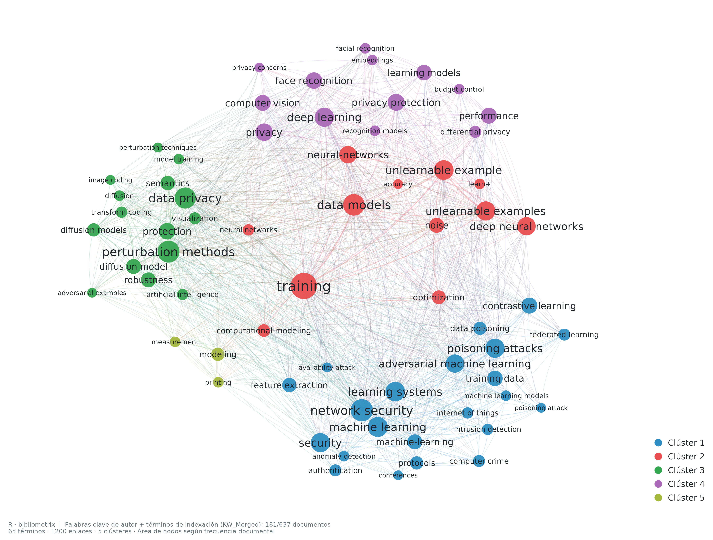

# Cadena P · Bibliometrix en R

Flujo de análisis exclusivamente en R con **bibliometrix**, sin Python y sin enriquecimiento de metadatos ni incorporación de publicaciones externas.

## Compartir y descargar

Este repositorio contiene los cinco exports originales, los scripts de R, las tablas, los objetos R, los gráficos y el atlas PDF. Para consultar los resultados **no necesitas instalar R**.

- [Descargar todo el proyecto en ZIP](https://github.com/glender222/rsl-cadena-p-bibliometrix/archive/refs/heads/main.zip).
- [Abrir el atlas completo: 14 figuras, 15 páginas](resultados/Atlas_bibliometrico_Cadena_P.pdf).
- [Ver las figuras PNG, PDF y SVG](resultados/graficos/).

**Colección:** 738 registros exportados → 637 documentos únicos, tras consolidar 101 duplicados. Se conservó toda la colección aportada; no representa un corpus final de estudios incluidos tras cribado.

La red siguiente combina palabras clave de autor y términos de indexación (`KW_Merged`) disponibles en **181 de los 637 documentos**. Muestra 65 términos, 1200 enlaces y 5 clústeres calculados con bibliometrix. El diseño se inspira en VOSviewer y se genera íntegramente desde R.



## Obtener una copia con Git

```bash
git clone https://github.com/glender222/rsl-cadena-p-bibliometrix.git
cd rsl-cadena-p-bibliometrix
```

## Ver los resultados

- [Atlas completo](resultados/Atlas_bibliometrico_Cadena_P.pdf).
- [Figuras y métodos](resultados/LEEME_RESULTADOS.md).
- [Gráficos individuales](resultados/graficos/).
- [Tablas y coordenadas](resultados/tablas/).

## Volver a ejecutar

Desde esta carpeta:

```bash
./ejecutar.sh
```

R instala dependencias en `~/.local/share/cadena-p/R-library`. También puede aprovechar paquetes de `~/R/library`. No se modifican los cinco exports originales de `P/`.

En Debian 13, si faltan encabezados de desarrollo de curl/OpenSSL/libuv, se pueden obtener dependencias R precompiladas **sin sudo**:

```bash
bash scripts/dependencias_debian.sh
Rscript scripts/instalar.R
./ejecutar.sh
```

Se requiere R 4.5 o compatible, fuentes DejaVu Sans y las bibliotecas gráficas del sistema. Las versiones efectivamente utilizadas quedan registradas en `resultados/auditoria/sessionInfo.txt` y `resultados/tablas/versiones_paquetes.csv`.

## Redactar el nuevo artículo con LaTeX

El entorno de redacción usa Docker y LaTeX Workshop, con la clase editorial `sn-jnl` y el estilo numérico `sn-mathphys-num`. Se incorporó el manuscrito completo de **entrega_codex_RSL.zip**, aportado por el equipo: portada e introducción, antecedentes, método, resultados, discusión, amenazas a la validez, conclusiones, declaraciones y apéndice. Los archivos se organizan en `articulo/secciones/`, `articulo/tablas/` y `articulo/figuras/`, con 18 tablas, cinco figuras PDF y 69 referencias bibliográficas citadas.

El [PDF de trabajo](articulo/build/manuscrito.pdf) contiene el manuscrito completo de 35 páginas, compilado con Docker. El manuscrito también compiló correctamente en el editor integrado. Se conservaron los autores y la afiliación completos. El enlace a la tabla de preguntas de investigación ya tiene destino. Siguen pendientes los campos marcados con `\pend{...}`. Las cifras se trasladaron sin recalcularlas.

1. Abrir la carpeta completa del repositorio en VS Code y tener Docker iniciado.
2. Instalar la extensión recomendada **LaTeX Workshop** (`james-yu.latex-workshop`).
3. Redactar en [articulo/manuscrito.tex](articulo/manuscrito.tex).
4. Al guardar, VS Code ejecuta la compilación con Docker y actualiza **un único PDF** en `articulo/build/manuscrito.pdf`.

También puedes compilar con **Ctrl+Shift+B**. La [guía de redacción](articulo/LEEME.md) indica dónde empezar la introducción y cómo gestionar citas y figuras.

También se puede compilar desde la raíz del proyecto:

```bash
bash compilar-articulo.sh
```

La imagen `rsl-latex:trixie` se reutiliza si existe; en otro equipo se construye automáticamente con `Dockerfile.latex`. No hace falta instalar LaTeX en el equipo. En Windows, ejecutar el script desde WSL con Docker Desktop integrado.

Las referencias van en [articulo/referencias.bib](articulo/referencias.bib) y las figuras en `articulo/figuras/`. Se comparte un único PDF actualizado en `articulo/build/manuscrito.pdf`; los archivos temporales de compilación quedan excluidos de Git. Los datos y gráficos bibliométricos del proyecto siguen disponibles como resultados separados.

## Scripts

1. `01_importar.R`: lectura de los cinco exports y mapeo a tags de bibliometrix.
2. `02_depurar.R`: deduplicación conservadora y cobertura de metadatos.
3. `03_graficos.R`: análisis descriptivo, redes, MCA, clustering y mapa temático.
4. `04_flujos_acoplamiento.R`: tres campos nativo/interactivo y acoplamiento.
5. `05_entrega.R`: verificaciones independientes, atlas PDF y guía de resultados.
6. `06_red_estilo_vos.R`: redes de coocurrencia con enlaces curvos y etiquetas centradas; admite `DE` o `KW_Merged`.

Las funciones de bibliometrix empleadas incluyen `convert2df`, `metaTagExtraction`, `biblioAnalysis`, `cocMatrix`, `biblioNetwork`, `networkPlot`, `conceptualStructure`, `thematicMap` y `threeFieldsPlot`. La presentación final se ajusta con herramientas gráficas de R; los valores estadísticos se conservan.

## Ajustar el aspecto

### Red con composición similar a VOSviewer

Calculada en R con `biblioNetwork()` y `networkPlot()`. Se conserva el número de comunidades de Louvain; se acomodan las posiciones gráficas y etiquetas centradas, con enlaces curvos y colores por comunidad. No se emplea VOSviewer ni se añaden términos o enlaces.

```bash
# Autor + indexación: 181 documentos con estos metadatos; versión más densa.
Rscript scripts/06_red_estilo_vos.R KW_Merged
# Solo palabras clave de autor: 134 documentos con DE.
Rscript scripts/06_red_estilo_vos.R DE
```

Los archivos empiezan con `14_red_coocurrencia_KW_Merged_estilo_VOS` y `13_red_coocurrencia_estilo_VOS`, respectivamente, en PNG de 300 ppp, SVG y PDF. Las coordenadas y los enlaces verificados están en `resultados/tablas/`; los objetos nativos de bibliometrix, en `resultados/objetos/`.

- Paleta, tipografía y tamaños de exportación: `scripts/00_config.R`.
- Coordenadas de nodos y nube: CSV de `resultados/tablas/`.
- Redes: parámetros `n`, `minfreq`, `minedge` en `03_graficos.R`.
- Etiquetas: `geom_text_repel` con semilla fija. Sus líneas indican el punto original.
- Tres campos: posiciones de nodos y cintas en `04_flujos_acoplamiento.R`.

No mover las coordenadas factoriales para cambiar la interpretación del análisis. El archivo `coordenadas_factoriales_MCA.csv` guarda los valores calculados por bibliometrix.
