# Bibliometría de la cadena P

**738 registros originales → 637 documentos únicos; 101 duplicados consolidados.**

Se analizaron exclusivamente los cinco archivos de `P/`. No se añadieron artículos, referencias, palabras clave ni afiliaciones de otras fuentes. Esta es la colección recuperada por la búsqueda; no se ha supuesto que todos los resultados cumplan criterios de inclusión de la RSL.

## Entregables

- `Atlas_bibliometrico_Cadena_P.pdf`: atlas de figuras.
- `graficos/`: cada gráfico en PNG de 300 ppp, PDF y SVG vectoriales.
- `interactivos/08_three_field_plot.html`: versión interactiva nativa del diagrama de tres campos (conservar la carpeta `lib/` junto al HTML).
- `tablas/`: corpus, trazabilidad, frecuencias, matrices de enlaces y coordenadas.
- `objetos/`: resultados R originales de bibliometrix.
- `auditoria/`: hashes originales, logs, validaciones y versiones.

## Cobertura

| Campo | Documentos | Cobertura |
|---|---:|---:|
| TI | 637/637 | 100.0% |
| AU | 192/637 | 30.1% |
| PY | 637/637 | 100.0% |
| DE | 134/637 | 21.0% |
| ID | 176/637 | 27.6% |
| AB | 191/637 | 30.0% |
| C1 | 192/637 | 30.1% |
| AU_CO | 183/637 | 28.7% |
| CR | 156/637 | 24.5% |
| DI | 606/637 | 95.1% |
| TC | 180/637 | 28.3% |

## Figuras

### 01 wordcloud

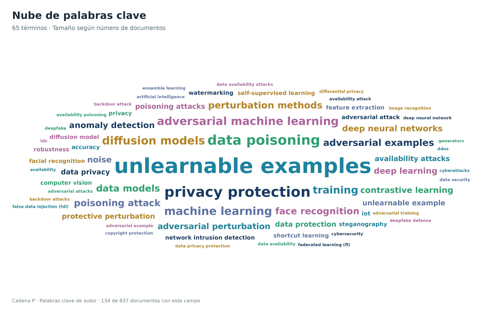

[PDF](graficos/01_wordcloud.pdf) · [SVG editable](graficos/01_wordcloud.svg)

### 02 coocurrencia

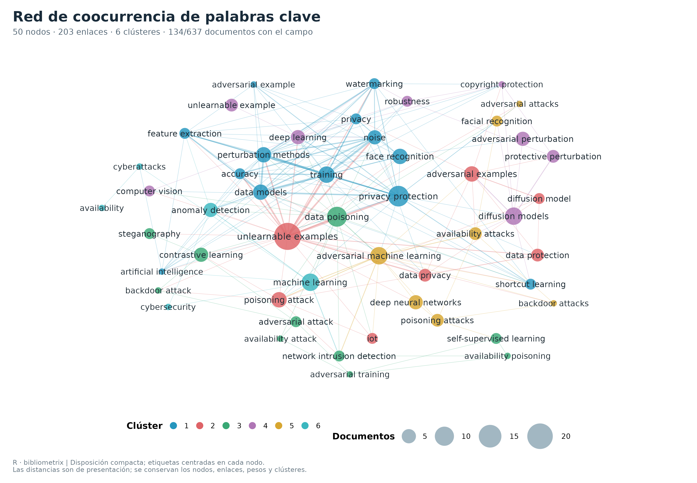

[PDF](graficos/02_coocurrencia.pdf) · [SVG editable](graficos/02_coocurrencia.svg)

### 03 colaboracion autores

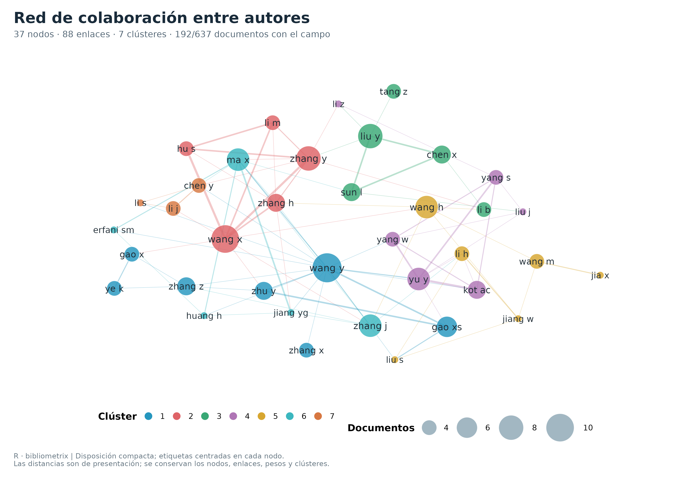

[PDF](graficos/03_colaboracion_autores.pdf) · [SVG editable](graficos/03_colaboracion_autores.svg)

### 04 colaboracion paises

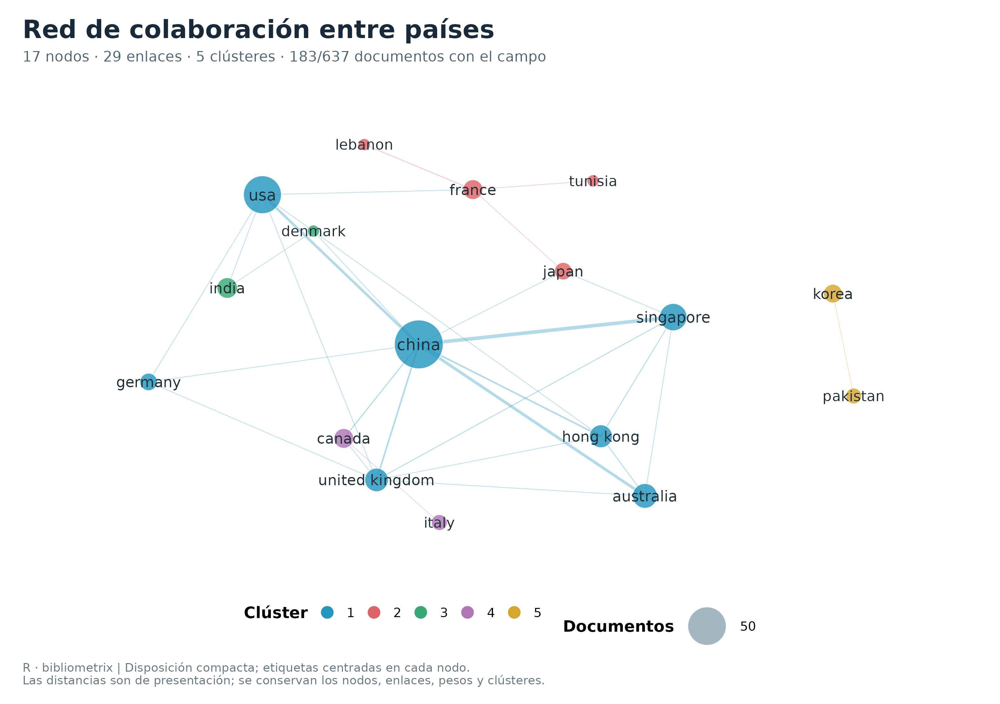

[PDF](graficos/04_colaboracion_paises.pdf) · [SVG editable](graficos/04_colaboracion_paises.svg)

### 05 mapa factorial MCA

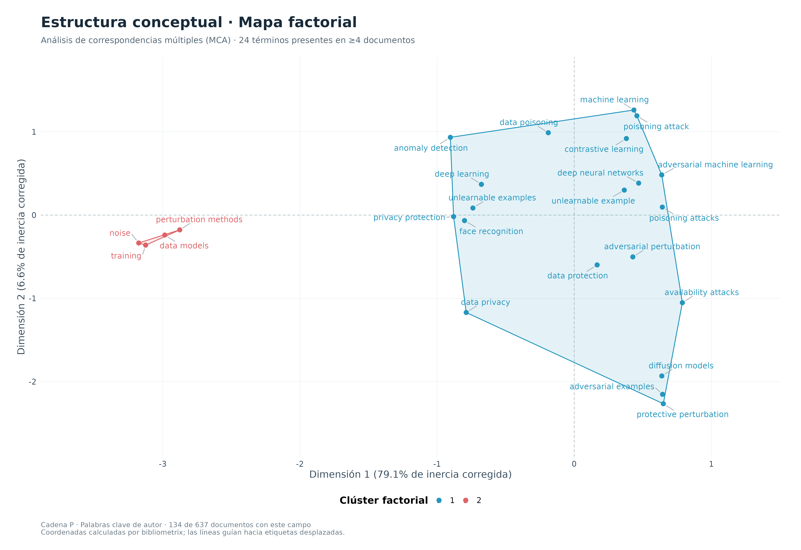

[PDF](graficos/05_mapa_factorial_MCA.pdf) · [SVG editable](graficos/05_mapa_factorial_MCA.svg)

### 06 clustering dendrograma

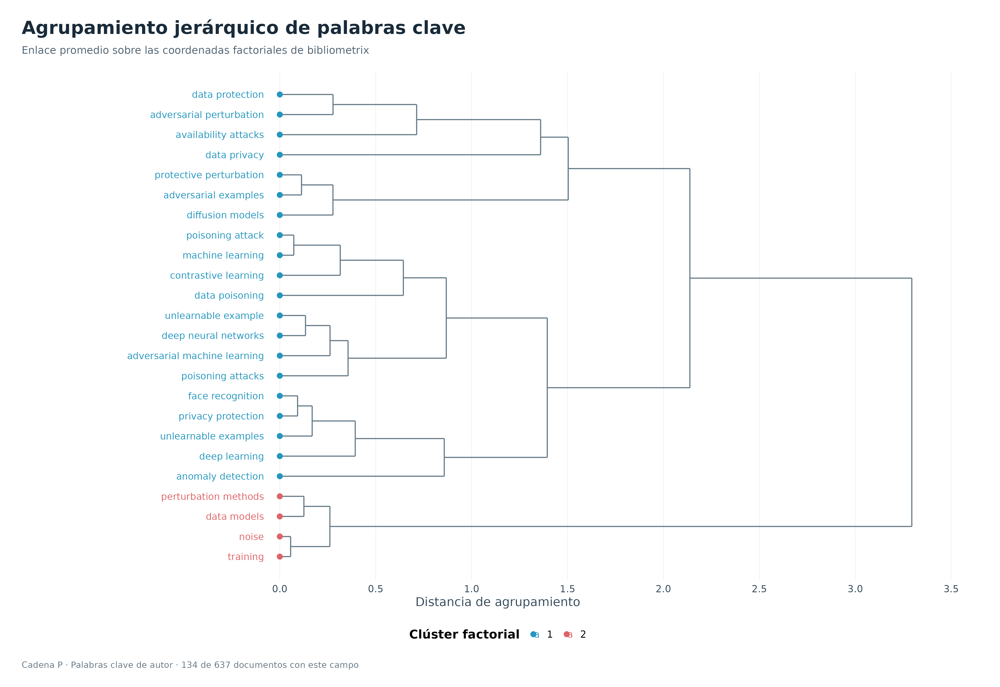

[PDF](graficos/06_clustering_dendrograma.pdf) · [SVG editable](graficos/06_clustering_dendrograma.svg)

### 07 mapa tematico

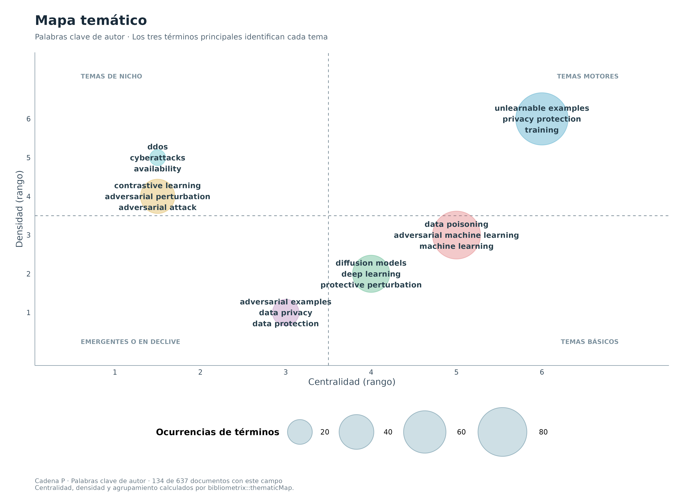

[PDF](graficos/07_mapa_tematico.pdf) · [SVG editable](graficos/07_mapa_tematico.svg)

### 08 three field plot

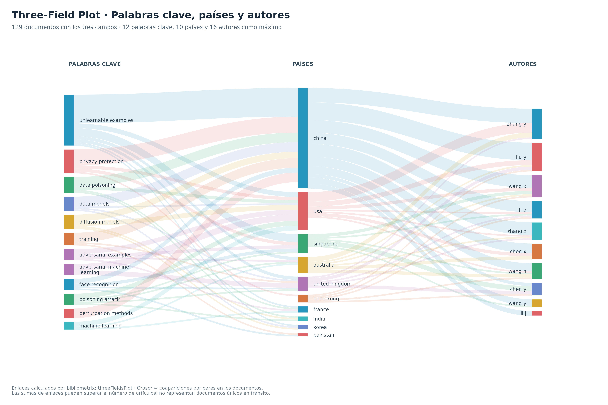

[PDF](graficos/08_three_field_plot.pdf) · [SVG editable](graficos/08_three_field_plot.svg)

### 09 produccion anual

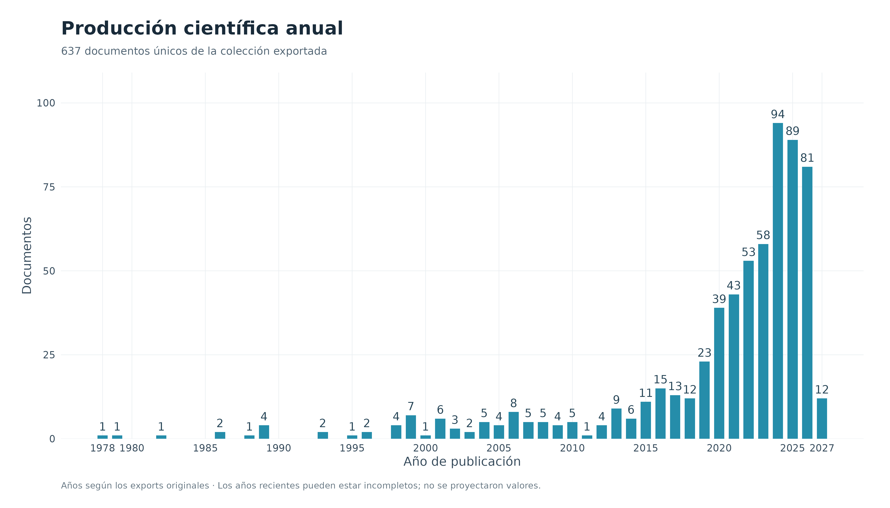

[PDF](graficos/09_produccion_anual.pdf) · [SVG editable](graficos/09_produccion_anual.svg)

### 10 fuentes publicacion

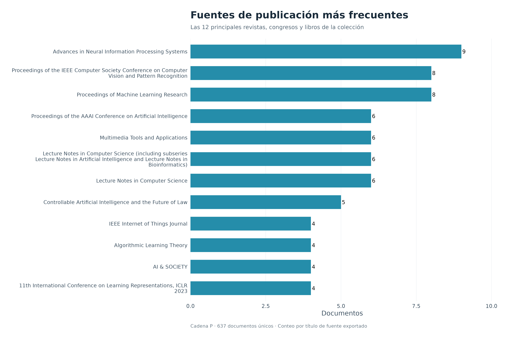

[PDF](graficos/10_fuentes_publicacion.pdf) · [SVG editable](graficos/10_fuentes_publicacion.svg)

### 11 frecuencias keywords

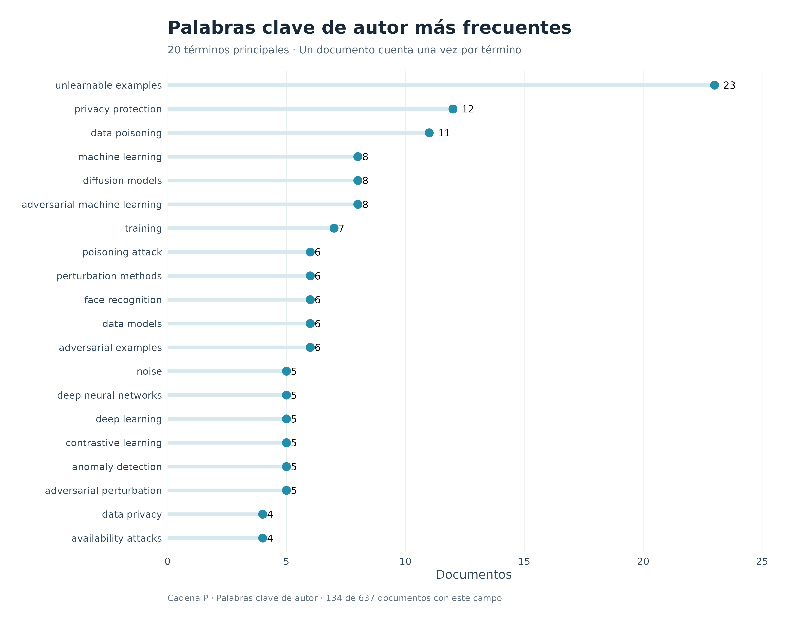

[PDF](graficos/11_frecuencias_keywords.pdf) · [SVG editable](graficos/11_frecuencias_keywords.svg)

### 12 acoplamiento bibliografico

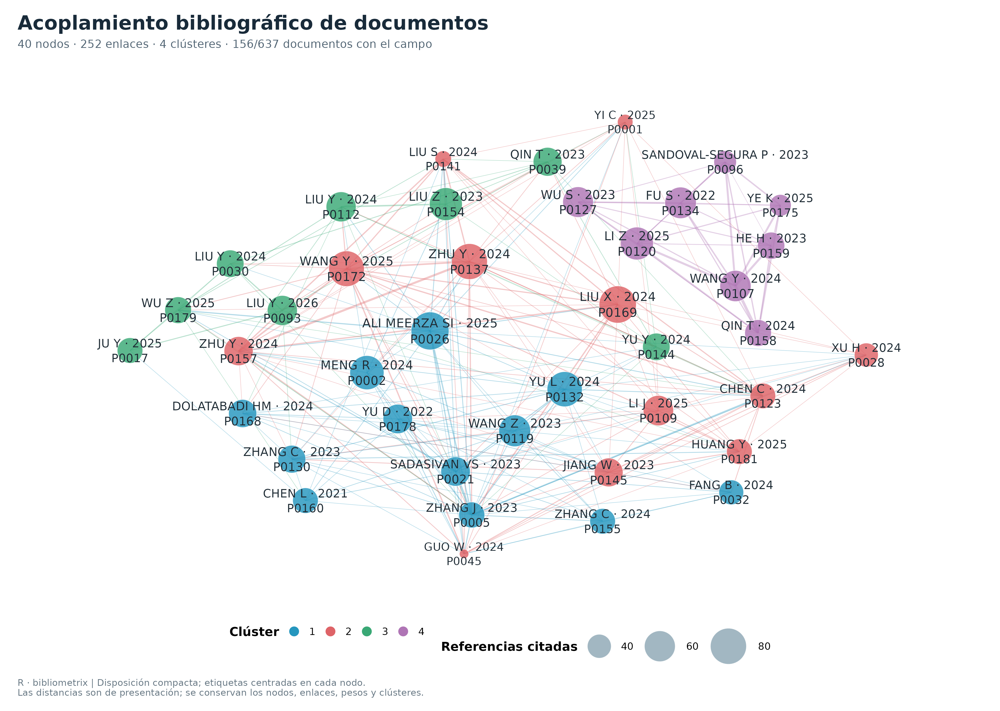

[PDF](graficos/12_acoplamiento_bibliografico.pdf) · [SVG editable](graficos/12_acoplamiento_bibliografico.svg)

### 13 red coocurrencia estilo VOS

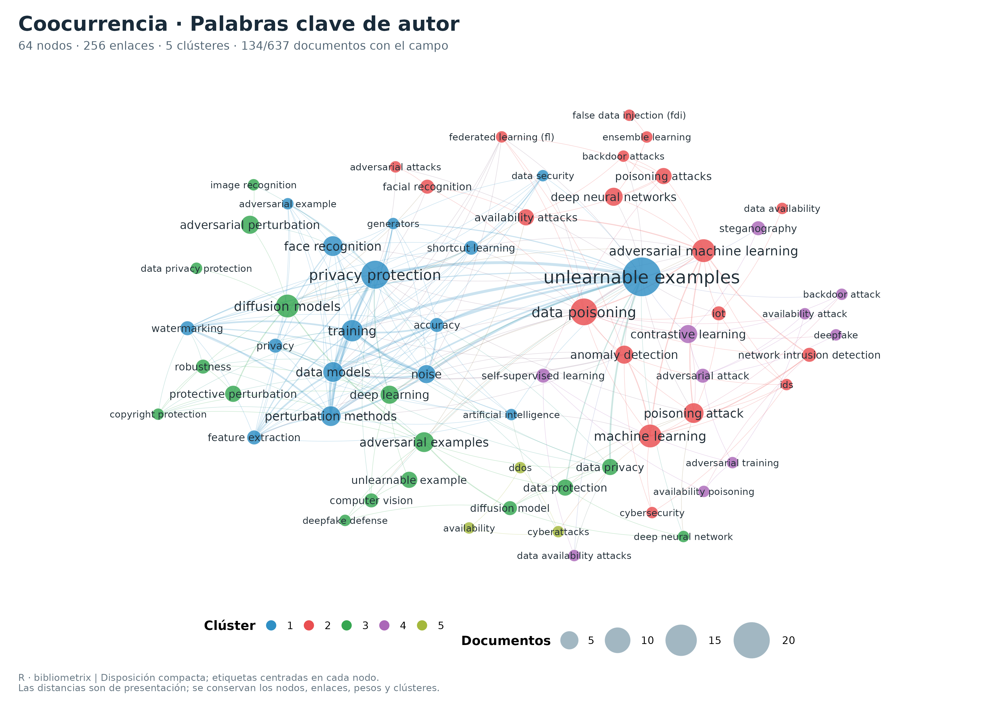

[PDF](graficos/13_red_coocurrencia_estilo_VOS.pdf) · [SVG editable](graficos/13_red_coocurrencia_estilo_VOS.svg)

### 14 red coocurrencia KW Merged estilo VOS

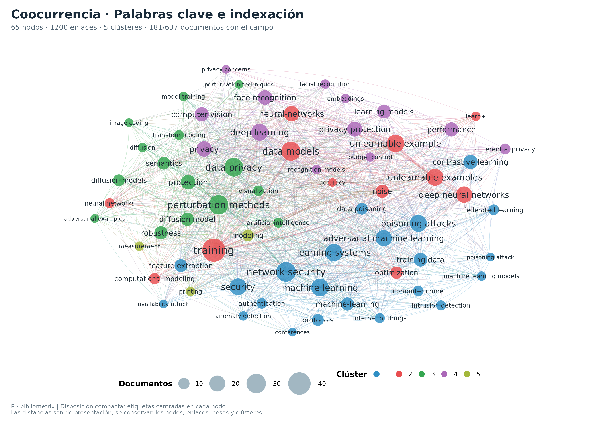

[PDF](graficos/14_red_coocurrencia_KW_Merged_estilo_VOS.pdf) · [SVG editable](graficos/14_red_coocurrencia_KW_Merged_estilo_VOS.svg)

## Métodos y límites

1. **Importación.** Scopus se convierte también con `convert2df`. WoS XLS, IEEE y Springer se mapean a los tags de bibliometrix en R, sin consultar servicios externos. Se conservan los datos originales como objetos R y los cinco archivos quedan intactos.
2. **Duplicados.** Se agrupan DOI exactos normalizados y títulos exactos normalizados cuando no hay DOI incompatibles. No se aplica fusión difusa. Prioridad para campos escalares: Scopus, WoS, IEEE, Springer; keywords se unen sin duplicarlas. Los conflictos de año y citas se guardan en CSV.
3. **Autores.** Se unifican puntuación y formato apellido/iniciales cuando los delimitadores son explícitos. Los homónimos con iguales iniciales no quedan desambiguados. Los autores concatenados de Springer no se usan en las redes salvo que otra base aporte nombres separables para el mismo DOI/título.
4. **Palabras clave.** Se usa DE (author keywords), sin mezclarlo silenciosamente con términos de indexación. Solo se normalizan mayúsculas y espacios. No se añaden sinónimos, traducciones ni categorías temáticas elegidas manualmente. Cada documento cuenta como máximo una vez por término.
5. **Red conceptual.** `biblioNetwork` calcula coocurrencias; Louvain agrupa con pesos de fuerza de asociación. La figura limita términos y enlaces mediante umbrales visibles. Las posiciones iniciales se calculan con Fruchterman–Reingold y semilla fija; scripts/07_compactar_redes.R aproxima los centros de los grupos y acomoda los nodos con sus etiquetas, conservando todos los nodos, enlaces, pesos y comunidades. Las distancias mostradas son gráficas.
6. **Factorial.** `conceptualStructure(method="MCA")` calcula coordenadas y agrupamiento jerárquico con enlace promedio; el número de grupos se selecciona con la regla automática de bibliometrix. No se desplazan puntos para imitar una figura de referencia. Las etiquetas se repelen y conectan a sus puntos. El dendrograma corresponde a esta solución, que puede diferir de los grupos de Louvain de la red.
7. **Mapa temático.** `thematicMap` calcula centralidad y densidad. Un cuadrante de baja centralidad/densidad no distingue por sí solo un tema emergente de uno en declive.
8. **Tres campos.** `threeFieldsPlot` calcula relaciones keyword–país y país–autor por coaparición documental, con conteo completo; las sumas no son documentos únicos que fluyen por tres etapas. Los países son los identificables en las afiliaciones aportadas.
9. **Acoplamiento.** `biblioNetwork(analysis="coupling",network="references")` usa únicamente documentos con CR. Se corrigen los separadores de autores internos a referencias de Scopus; los fragmentos bibliográficos inválidos se excluyen y auditan. No se enriquecen referencias con fuentes externas. Variantes textuales de una misma referencia pueden quedar separadas.
10. **Cribado y chaining.** Sin decisiones de inclusión/exclusión y semillas no se puede presentar esto como corpus final de la RSL ni como un rastreo completo hacia adelante/atrás. La base aquí es exactamente la colección suministrada.

## Documentación de la biblioteca

- [Bibliometrix: importación](https://bibliometrix.org/vignettes/Data-Importing-and-Converting.html)
- [Manual oficial de bibliometrix](https://stat.ethz.ch/CRAN/web/packages/bibliometrix/refman/bibliometrix.html)
- [Código de threeFieldsPlot](https://github.com/massimoaria/bibliometrix/blob/master/R/threeFieldsPlot.R)
